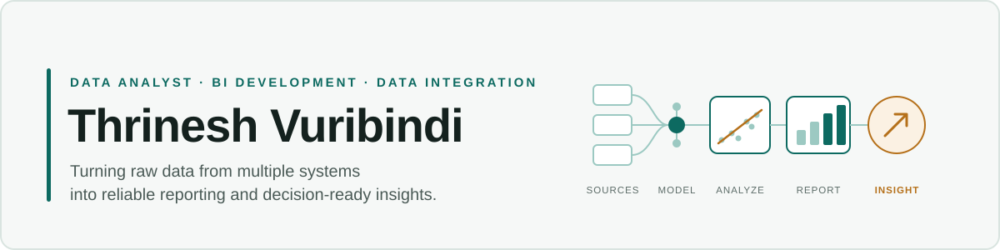

  

  
  
  
  

Data Analyst with 4.5+ years building ETL and data pipelines, data models, and Power BI dashboards. I monitor KPIs, run root cause analysis on performance and cost, and turn complex data into actionable recommendations for stakeholders.

Each project here starts with a business question and works through what is happening, why it is happening, and what action improves the outcome, with the code and documentation behind every number.

## Projects

<table>
<tr>
<td width="40%" valign="top"></td>
<td width="60%" valign="top">
<h3><a href="https://github.com/thrinesh13/Medicare-Claims-Payment-Integrity-Analytics">Medicare Claims Payment Integrity</a></h3>

<b>Question:</b> Which Medicare Part B claims can rules safely approve or deny before payment, and where does human review still matter? 
<b>Result:</b> 10 SQL prepayment edits route 96% of claims at 93.3% accuracy, catch 82% of improper claims, and cut modeled review cost from $425K to $120K. 
<b>In the repo:</b> 3 notebooks (data cleaning → core tables → payment integrity rules), staging, core, and mart layers in PostgreSQL, and a 4-page Power BI report (<code>.pbix</code>).

SQL · PostgreSQL · Python · Power BI · DAX

</td>
</tr>
</table>

<table>
<tr>
<td width="40%" valign="top"></td>
<td width="60%" valign="top">
<h3><a href="https://github.com/thrinesh13/Surgical-Scheduling-Variance-Analysis">Surgical Scheduling Variance Analysis</a></h3>

<b>Question:</b> How often do booked surgery durations miss, and which procedures drive the cost? 
<b>Result:</b> 53.3% of 48.1K cases miss by 30+ minutes. 133 of 418 procedures drive 53.6% of an estimated $15.8M to $27.1M yearly cost exposure. 
<b>In the repo:</b> bronze, silver, and gold notebooks in Microsoft Fabric (PySpark, 1.88M records), the Power BI semantic model as TMDL source files, and data lineage, data quality, and dashboard guide docs. 
<b>Live dashboard:</b> <a href="https://thrinesh13.github.io/Surgical-Scheduling-Variance-Analysis/dashboard/">open in your browser</a>

Microsoft Fabric · PySpark · Spark SQL · Power BI · DAX

</td>
</tr>
</table>

<table>
<tr>
<td width="40%" valign="top"></td>
<td width="60%" valign="top">
<h3><a href="https://github.com/thrinesh13/Statistical-Time-series-analysis">Statistical Time-Series Analysis</a></h3>

<b>Question:</b> Do four common beliefs about a fast-growing stock hold up against five years of Apple trading data? 
<b>Result:</b> 3 of 4 were rejected. Volatility held near 1.65% a day as the price rose from $146 to $311, and volume did not predict price. 
<b>In the repo:</b> one notebook covering cleaning, trend, correlation, distribution, and hypothesis testing on 1,254 trading days, plus a data dictionary and charts.

Python · pandas · SciPy · Matplotlib

</td>
</tr>
</table>

## Toolkit

| Stage | Tools |
| :--- | :--- |
| **Ingest and integrate** | SQL · Python · Azure Data Factory · SSIS · Airflow · dbt |
| **Store and model** | Snowflake · Microsoft Fabric · SQL Server · Oracle · PostgreSQL · Databricks |
| **Validate and govern** | Data profiling · Reconciliation · Data lineage · Row-level security |
| **Analyze** | SQL (CTEs, window functions) · Python (pandas) · Excel · Statistical testing · Forecasting |
| **Report** | Power BI (DAX, Power Query, Power BI Service) · Tableau · SSRS |

Open to data roles · Open to relocation · <a href="https://thrinesh13.github.io/">Full experience on my portfolio</a>

